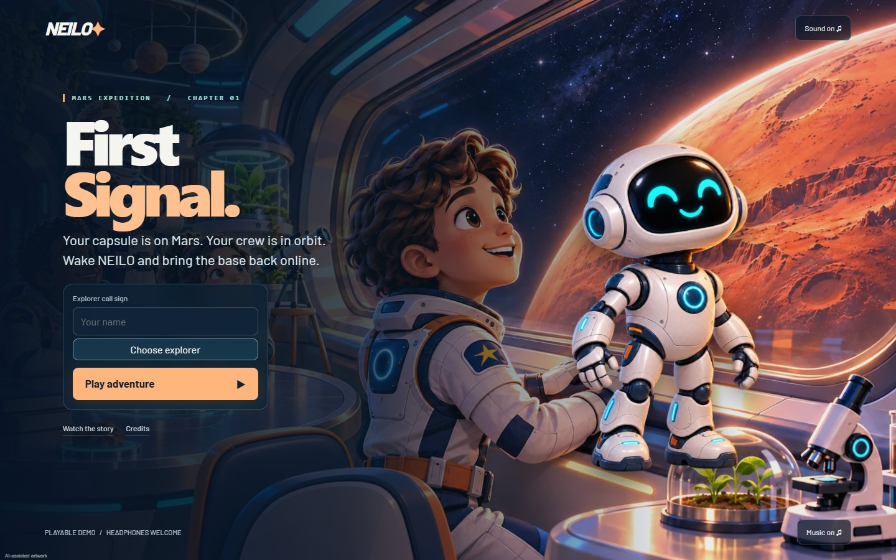
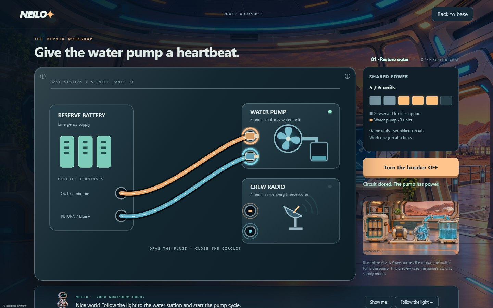
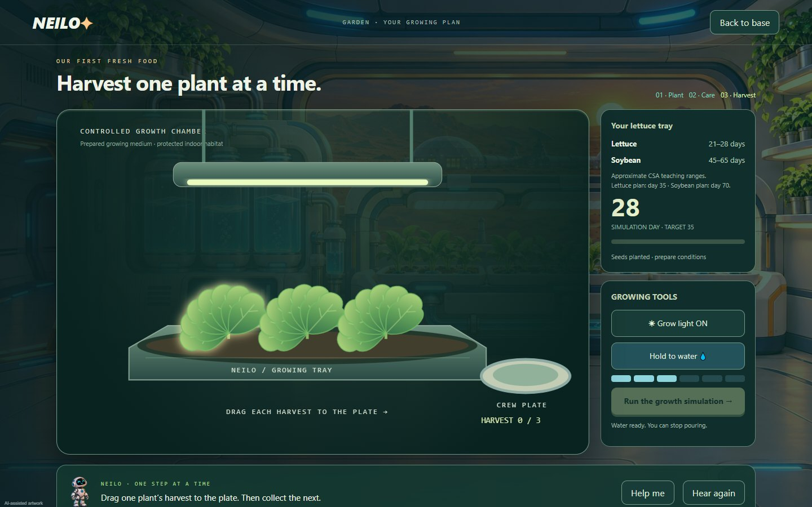
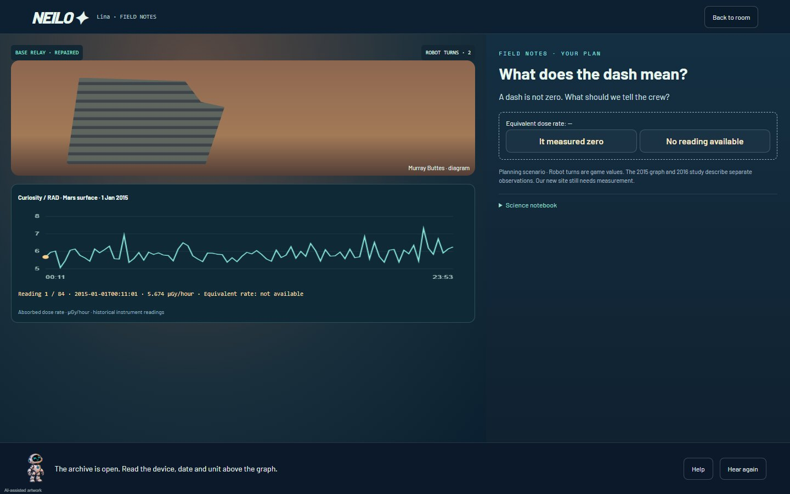
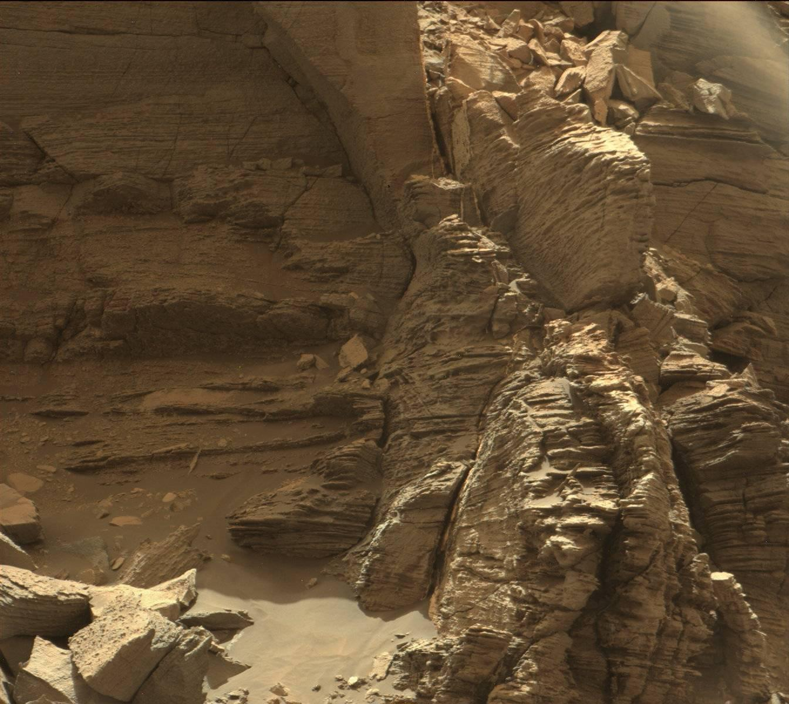

# NEILO · First Signal

### A child. A lost capsule. A little robot. A way forward.

A playable Mars adventure designed for explorers aged 7–12.

**[▶ PLAY THE DEMO](https://zeroomood5-create.github.io/the-neilo-project/)** &nbsp; · &nbsp; **[Science & sources](#real-space-science-inside-the-game)** &nbsp; · &nbsp; **[Full documentation](docs/SUBMISSION_DOSSIER.md)**

No installation, account or API key required.

*Playable chapter one · English narration · Browser save · Desktop and touch controls*

## You are part of the expedition

A guidance fault separates your safety capsule from the crew’s ship. You land beside an old research base on Mars; your crew stays in orbit. Emergency air and heat are running, but the other systems need attention.

A small blue light leads you to **NEILO**. Together, you restore equipment, prepare supplies, reach the crew and learn what real rover evidence can—and cannot—tell you.

Choose an explorer name and a full-body suit. Your name appears in the world, guidance and journey log. NEILO offers short spoken instructions and highlights the next useful action when you need help.

## Learn by doing

| Mission | Your action | The idea behind it |
| --- | --- | --- |
| **Find NEILO** | Follow a glowing floor target, meet the robot and learn to ask for help. | A guided first action makes the world understandable. |
| **Bring power online** | Drag both cable plugs into matching sockets, close the circuit and start the pump. | Electrical equipment needs a connected circuit. |
| **Prepare water** | Use the powered pump and stored energy to prepare supplies. | Resources are connected; packs and battery costs are game values. |
| **Reach the crew** | Reconnect the radio, tune the antenna and transmit. | Jobs can take turns using a limited supply. |
| **Grow something fresh** | Choose lettuce or soybean, provide light and water, run the simulation and harvest plants separately. | Growing time and preparation affect a food plan. |
| **Read rover evidence** | Inspect Curiosity readings, identify missing data, repair the relay and send notes. | Missing data is not zero; a new site needs its own measurements. |

Short explanations connect missions to science. Discovery questions offer feedback and another attempt. Required questions resume after reloading. The finale follows the garden, field report, repaired relay and final question.

### Connect it. Grow it. Understand it.

| Close the circuit | Harvest one plant at a time |
| --- | --- |
|  |  |

*Actual screenshots of the published game, using saved demo checkpoints and the fictional name Lina. [Capture script](scripts/capture-readme.mjs)*

## Real space science inside the game

NASA data changes what the player reads and reports. Agency educational resources also shape crop choices and explanations.

| Resource | What we used | How it affects play |
| --- | --- | --- |
| **NASA OSDR RadLab · Curiosity / RAD** | **84 historical Mars-surface absorbed dose rate readings**, from **1 January 2015**, in **µGy/hour**. All equivalent-dose values in this sample are unavailable. | An interactive graph and a decision to label missing readings honestly. [Data](dist/data/rad-2015-01-01.json) · [Exact query & retrieval record](data/review-2026-11-13/rad-provenance.json) · [NASA API](https://visualization.osdr.nasa.gov/radlab/gui/data-api/) |
| **NASA/JPL & Ehresmann et al. · M12** | A separate **September 2016** study found about a **4% reduction in expected dose rate** at that location. | Optional report evidence; it does not prove another site is safe. [Paper](https://doi.org/10.1029/2021JE006851) · [JPL account](https://www.jpl.nasa.gov/news/how-nasas-curiosity-rover-is-making-mars-safer-for-astronauts/) |
| **NASA/JPL · Curiosity Mastcam** | Original Mars photograph **PIA21044**, taken **8 September 2016**. | **Look outside** opens a credited rover photograph. [Image record](https://www.jpl.nasa.gov/images/pia21044-farewell-to-murray-buttes-image-4/) |
| **Canadian Space Agency · Interplanetary farming** | Approximate teaching ranges: lettuce **21–28 days**, soybean **45–65 days**, plus preparation examples. | Crop comparison, calendar and soybean preparation. These are not Mars-grown crop measurements. [CSA resource](https://www.asc-csa.gc.ca/eng/youth-educators/activities/fitness-and-nutrition/interplanetary-farming.asp) |
| **ESA · Astrofarmer** | Light, water and other suitable growing conditions. | The garden models part of a plant’s environment. [Educator guide](https://climatedetectives.esa.int/wp-content/uploads/2023/09/PR42_AstroFarmer-1.pdf) |
| **NASA · Spacecraft and Hubble power** | Solar electricity, stored energy and electrical equipment. | Power and water explanations connect actions to energy ideas. [Space Place](https://spaceplace.nasa.gov/what-powers-a-spacecraft/en/) · [Hubble power](https://science.nasa.gov/mission/hubble/observatory/design/electrical-power/) |

<b>Through Curiosity’s eyes — the original Mars photograph</b>

**Credit: NASA/JPL-Caltech/MSSS · PIA21044.** This original photograph is distinct from the AI-assisted fictional environments.

**Science and simulation:** the expedition is fictional. Power slots, water packs, radio channels, robot turns and animation speeds are game values. The growing calendar is a training simulation. Radiation readings are not a medical assessment or safety guarantee. The 2015 archive and 2016 study remain separate observations.

Public play uses bundled records without a live NASA API connection. DONKI, Mars Trek and proposed space-health simulations are research candidates, not active datasets in this chapter. [Source mapping, checks and limits](docs/SUBMISSION_DOSSIER.md)

## A complete first chapter

The finale celebrates restoring the base and sending an evidence-based report. Credits identify the team, tools and sources, then introduce the next expedition: **leaving the airlock to explore the Martian surface**.

This is a **demo of NEILO’s journey on Mars**. Surface exploration is future content. Public personalization uses a name and selectable explorer art; live photo-to-character generation is outside this static demo.

## How we built it

- **Game:** HTML, CSS, JavaScript, Canvas and Web Audio; GitHub Pages hosting.
- **Voice:** 88 installed Michael clips across guidance, garden explanations and chapter narration, generated locally with Kokoro. Supplied crew performances retain their credits. Names are text-only; unmatched dynamic lines may remain caption-only.
- **Visuals:** AI-assisted environments and characters, supplied Flow cinematics, authored SVG icons and an unmodified NASA photograph.
- **Production:** Python, Node.js, FFmpeg, FFprobe and Git for media preparation, backups and releases.
- **Checks:** 16 state tests, browser journeys through the finale, both crops, separate harvest/save recovery, question guards, responsive layouts and audio playback. These verify software behavior, not learning outcomes.

AI assistance is disclosed in the credits and production records. NASA does not endorse this project. The supplied Interstellar recording remains in the build; the repository does not establish its redistribution license.

## Explore the project

| Document | What it explains |
| --- | --- |
| [Submission dossier](docs/SUBMISSION_DOSSIER.md) | Experience, features, science and evidence limits |
| [Tools & provenance](docs/TOOLS_AND_PROVENANCE.md) | AI assistance, tools and production |
| [Asset metadata](docs/ASSET_METADATA.json) | Credits, provenance and hashes |
| [Narration audit](docs/NARRATION_AUDIT.md) | Voice coverage and text-only lines |
| [Current release](RELEASE_CURRENT.md) | Publication records and verification |
| [Story film prompts](production/FLOW_ARRIVAL_RECAP.md) | Briefs for the next recap film |
| [30-second presentation](production/capture-20261114/README.md) | Gameplay recording and editor handoff |
| [Development guide](docs/DEVELOPMENT.md) | Local setup, tests and publishing |

---

**Concept and direction: Ahmed Barakat & the NEILO team.** Updated 14 November 2026, Africa/Cairo. Original scientific observation dates, asset provenance and development history are preserved.
